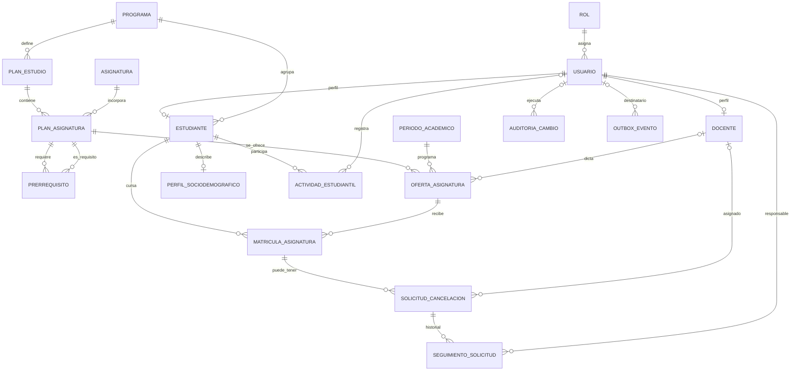

# Guía de base de datos y pruebas de API

Este documento describe el esquema PostgreSQL `gestion_estudiantil`, las relaciones que aparecen en la migración inicial y una ruta práctica para probar la API Spring Boot. La fuente del esquema es `src/main/resources/db/migration/V1__crear_esquema_inicial.sql`; la migración está desactivada en la configuración actual y Hibernate valida las tablas existentes (`ddl-auto=validate`), así que iniciar la aplicación no crea el esquema.

## 1. Tablas y propósito

| Tabla | Propósito y datos relevantes |
|---|---|
| `rol` | Catálogo fijo de roles: `ESTUDIANTE`, `DOCENTE`, `ADMINISTRADOR`. |
| `usuario` | Identidad local enlazada a un rol; correo único sin distinguir mayúsculas, nombre, apellido y estado activo. La autenticación Firebase se asocia por correo. |
| `programa` | Catálogo de programas académicos. |
| `estudiante` | Perfil académico de un usuario estudiante: programa, código, fecha de ingreso y estado. Un usuario puede tener como máximo un perfil estudiante. |
| `docente` | Perfil docente de un usuario; código docente opcional y estado activo. Un usuario puede tener como máximo un perfil docente. |
| `plan_estudio` | Versión curricular de un programa, con código, versión y vigencia. |
| `asignatura` | Catálogo general de materias con código, nombre, créditos y estado. |
| `plan_asignatura` | Vincula una asignatura a un plan y especifica semestre sugerido y obligatoriedad. Evita repetir la misma materia dentro de un plan. |
| `prerrequisito` | Relación de una asignatura del plan con otra asignatura del mismo ámbito curricular que debe cursarse antes. Su clave primaria es compuesta. |
| `periodo_academico` | Periodos académicos con código y fechas de inicio y fin. |
| `oferta_asignatura` | Sección/grupo de una asignatura del plan en un periodo; puede tener cupo y docente. |
| `matricula_asignatura` | Inscripción de un estudiante a una oferta, estado académico y nota final. No permite duplicar estudiante/oferta. |
| `solicitud_cancelacion` | Solicitud de cancelación asociada a una matrícula y al estudiante propietario; puede asignarse a un docente y tiene estado/fechas. |
| `seguimiento_solicitud` | Historial de cambios de estado y observaciones de una solicitud, con el usuario responsable. |
| `perfil_sociodemografico` | Datos opcionales de residencia, estrato, situación laboral y necesidad de apoyo; máximo un registro por estudiante. |
| `actividad_estudiantil` | Actividades integrales del estudiante (congresos, semilleros, proyectos, publicaciones, deporte u otras), con evidencia y usuario que la registró. |
| `auditoria_cambio` | Registro de operaciones `INSERT`, `UPDATE`, `DELETE`, usuario, entidad, identificador y valores anteriores/nuevos en JSONB. Es de consulta; no se edita desde la API. |
| `outbox_evento` | Cola interna de eventos para publicar notificaciones en Firebase Realtime Database; contiene payload, reintentos, error y fecha de procesamiento. |

### Reglas importantes del esquema

- Los identificadores son `BIGINT` identity salvo la clave compuesta de `prerrequisito`.
- Las notas aceptadas van de 0 a 5; los créditos deben ser positivos; el estrato va de 1 a 6.
- Fechas de cierre/fin no pueden preceder a su fecha inicial.
- Una matrícula no puede repetirse para el mismo estudiante y oferta.
- Solo se permite una solicitud en estado `PENDIENTE` o `EN_REVISION` por matrícula. Después de cerrarse puede registrarse otra.
- La FK compuesta de `solicitud_cancelacion(matricula_id, estudiante_id)` garantiza que la solicitud pertenece al dueño de la matrícula.
- Varias bajas administrativas son lógicas; las claves foráneas protegen el historial.

## 2. Diagrama de relaciones



`prerrequisito` es una relación autorreferente entre dos filas de `plan_asignatura`; el esquema impide que una materia sea su propio prerrequisito, pero no declara una FK compuesta que fuerce que ambas materias estén en el mismo plan. Las relaciones marcadas como opcionales permiten FK nula, por ejemplo docente en una oferta.

## 3. Autenticación y preparación

1. Levanta PostgreSQL con la base configurada (`DB_HOST`, `DB_PORT`, `DB_NAME`, `DB_USERNAME`, `DB_PASSWORD`) y confirma que contiene el esquema y las tablas. Los valores locales por defecto están en `src/main/resources/application.properties`.
2. Configura Firebase Admin en backend si vas a validar tokens o crear cuentas. La autenticación requiere un token Firebase válido, correo verificado y usuario activo en `gestion_estudiantil.usuario` con el mismo correo. El rol local decide los permisos.
3. Arranca el backend desde la raíz: `./mvnw spring-boot:run` (Windows: `.\mvnw.cmd spring-boot:run`). Base URL predeterminada: `http://localhost:8080`.
4. Consulta Swagger en `http://localhost:8080/swagger-ui/index.html` o OpenAPI en `/v3/api-docs`. Usa **Authorize** con `Bearer <ID token>` para endpoints protegidos. Sin token, inválido/no verificado, usuario no provisionado o inactivo: se espera `401`; rol incorrecto: `403`.
5. Prepara tres cuentas (estudiante, docente y administrador) y datos de referencia. No hay endpoint público de login ni endpoint para crear el primer administrador; aprovisiónalo con cuidado en Firebase y PostgreSQL. Para casos de notificación también se requiere Firebase Realtime Database.

Las respuestas y cuerpos se pueden consultar en Swagger y en los DTO de `infrastructure/web/dto`. Los `DELETE` suelen responder `204 No Content`; revisa el contrato en Swagger para cada operación.

## 4. Flujo recomendado para probar

### A. Crear datos base (token de administrador)

Sigue el orden de dependencias; guarda los `id` devueltos para las operaciones siguientes:

1. Crear programa: `POST /api/admin/programas`.
2. Crear plan de estudio asociado al programa: `POST /api/admin/planes-estudio`.
3. Crear asignaturas: `POST /api/admin/asignaturas`.
4. Incorporarlas al plan: `POST /api/admin/plan-asignaturas` (requiere `planEstudioId`, `asignaturaId`; puede incluir `semestreSugerido` y `obligatoria`).
5. Crear prerrequisitos si aplica: `POST /api/admin/prerrequisitos` con los dos IDs de asignatura del plan.
6. Crear periodo: `POST /api/admin/periodos`.
7. Dar de alta un docente y un estudiante: `POST /api/admin/docentes` y `POST /api/admin/estudiantes`. Se crean en Firebase y PostgreSQL; la cuenta debe verificar correo antes de iniciar sesión. El estudiante requiere programa y código estudiantil.
8. Crear oferta: `POST /api/admin/ofertas` (asignatura del plan, periodo, grupo; docente/cupo opcionales).
9. Matricular al estudiante: `POST /api/admin/matriculas` con estudiante, oferta y estado admitido.

Ejemplo orientativo de cuerpos (nombres de propiedades camelCase; campos obligatorios exactos están en Swagger):

```json
{"codigo":"ING-SIS","nombre":"Ingeniería de Sistemas","activo":true}
```

```json
{"programaId":1,"codigo":"PLAN-2026","nombre":"Plan 2026","version":"1","fechaInicio":"2026-01-01","activo":true}
```

```json
{"codigo":"MAT101","nombre":"Matemáticas I","creditos":3,"activo":true}
```

```json
{"planEstudioId":1,"asignaturaId":1,"semestreSugerido":1,"obligatoria":true}
```

### B. Probar estudiante

Autentica con la cuenta estudiante y prueba en orden:

1. `GET /api/estudiantes/me` para confirmar identidad/perfil.
2. `PUT /api/estudiantes/me/datos-personales` para actualizar nombre y apellido; repite GET.
3. `GET /api/estudiantes/me/trayectoria` para revisar materias, matrícula y prerrequisitos.
4. `GET` y `PUT /api/estudiantes/me/sociodemografico`; verifica límite de estrato.
5. `GET /api/estudiantes/me/actividades`, luego `POST` con una actividad válida y vuelve a listar.
6. `POST /api/solicitudes` para una matrícula propia elegible. Guarda el ID; `GET /api/solicitudes/mias` y `GET /api/solicitudes/{id}` verifican detalle e historial.
7. `GET /api/notificaciones` después de que se procese el evento en outbox. `PATCH /api/notificaciones/{id}/leida` y vuelve a listar.

### C. Probar docente y ciclo de cancelación

Autentica con el docente creado; asegúrate de asignarlo a la oferta/caso si el flujo lo requiere.

1. `GET /api/docente/estudiantes?q=&programaId=&estado=`; luego consulta perfil, trayectoria, actividades y sociodemográfico usando los IDs del resultado: `/api/estudiantes/{id}/perfil`, `/trayectoria`, `/sociodemografico` y `/api/docente/estudiantes/{id}/actividades`.
2. `GET /api/docente/solicitudes?estado=PENDIENTE` para cargar la bandeja.
3. `PATCH /api/docente/solicitudes/{id}` con `{"estado":"EN_REVISION","observacion":"..."}` y verifica el seguimiento.
4. Prueba transición terminal `APROBADA` o `RECHAZADA` con observación. Al aprobar, se actualiza la matrícula, se persisten auditoría y outbox; después verifica notificación del estudiante. No pruebes una segunda solicitud activa para la misma matrícula: el esquema la rechaza.
5. Repite búsqueda/consulta con token de estudiante y espera `403` en las rutas exclusivas de docente.

### D. Probar reportes

Con token docente o administrador: `GET /api/reportes/solicitudes`, `/api/reportes/desempeno` y `/api/reportes/participacion`. Agrega filtros opcionales `programaId`, `periodoId`, `estado` según el reporte y compara los conteos con los registros de prueba. Las rutas de reportes están protegidas por rol.

### E. Probar CRUD administrativo restante

Con token administrador, para cada recurso prueba listar, detalle por ID, crear, actualizar y eliminación cuando esté expuesta:

- `programas`, `planes-estudio`, `asignaturas`, `plan-asignaturas` y `prerrequisitos`.
- `periodos` y `ofertas`.
- `estudiantes`, `docentes`, `matriculas` y `actividades`.
- Perfil: `GET/PUT /api/admin/estudiantes/{id}/sociodemografico`.
- Usuarios/roles: `GET /api/admin/usuarios`, `PATCH /api/admin/usuarios/{id}/rol` con `{"rol":"DOCENTE"}` (opcional `codigoDocente`).
- Auditoría: `GET /api/admin/auditoria?entidad=&registroId=&usuarioId=&page=0&size=20`.

En general no hay DELETE de matrícula, usuario/rol, perfil sociodemográfico, solicitud, auditoría o outbox. Prueba validaciones negativas: correo/códigos duplicados, FK inexistente, fechas invertidas, créditos/notas/estrato fuera de rango, prerrequisito propio, operación con rol equivocado y transición de estado no permitida. Hazlo en un entorno de desarrollo porque las pruebas escriben datos.

## 5. Inventario de endpoints

El inventario completo, incluido el CRUD administrativo, está en el README raíz y en Swagger. Los grupos principales son:

| Área | Endpoints |
|---|---|
| Perfil/trayectoria | `GET /api/estudiantes/me`; `PUT /api/estudiantes/me/datos-personales`; `GET /api/estudiantes/me/trayectoria`; consulta docente `/api/estudiantes/{id}/perfil` y `/trayectoria` |
| Búsqueda/acompañamiento | `GET /api/docente/estudiantes`; `GET /api/docente/estudiantes/{id}/actividades`; consulta de perfil sociodemográfico docente |
| Actividades | `GET/POST /api/estudiantes/me/actividades`; CRUD admin `/api/admin/actividades` |
| Perfil sociodemográfico | `GET/PUT /api/estudiantes/me/sociodemografico`; lectura docente; `GET/PUT /api/admin/estudiantes/{id}/sociodemografico` |
| Solicitudes | `POST /api/solicitudes`; `GET /api/solicitudes/mias`; `GET /api/solicitudes/{id}`; bandeja y `PATCH` docente en `/api/docente/solicitudes` |
| Reportes | `GET /api/reportes/solicitudes`, `/desempeno`, `/participacion` |
| Notificaciones | `GET /api/notificaciones`; `PATCH /api/notificaciones/{id}/leida` |
| Administración | CRUD de programas, planes, asignaturas, plan-asignaturas, periodos, ofertas, cuentas, matrículas y actividades; alta/eliminación de prerrequisitos; consulta/cambio de rol y consulta de auditoría |


