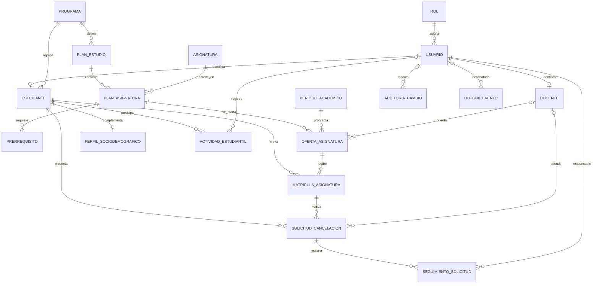

# Modelo de datos y decisiones de almacenamiento

## Alcance y fuentes de verdad

PostgreSQL, en el esquema `gestion_estudiantil`, conserva la información académica y transaccional que necesita integridad referencial: usuarios locales y roles, programas, planes, asignaturas, ofertas, matrículas, solicitudes, seguimiento, actividades, perfiles, auditoría y eventos pendientes. Las claves foráneas, restricciones `CHECK`, claves únicas e índices están definidos en `src/main/resources/db/migration/V1__crear_esquema_inicial.sql`.

Firebase Authentication verifica las credenciales y emite el token de identidad; no reemplaza la tabla local `usuario`, que enlaza el correo con el rol, el estado activo y los perfiles del dominio. Firebase Realtime Database se usa para notificaciones de lectura rápida. La solicitud y el seguimiento permanecen en PostgreSQL; `outbox_evento` guarda el evento en la misma transacción y un publicador lo entrega a Realtime Database. El ID del evento se reutiliza como clave de notificación para que un reintento sobrescriba el mismo registro.

Flyway sigue desactivado. La presencia del SQL en `db/migration` no significa que Spring Boot lo ejecute al iniciar. Hibernate valida el esquema existente con `ddl-auto=validate`; este documento y el SQL describen el modelo esperado sin alterar la base local.

## Diagrama relacional

`prerrequisito` es una relación de muchos a muchos de `plan_asignatura` consigo misma. `matricula_asignatura` materializa la relación estudiante-oferta, y permite varias asignaturas por estudiante y varios estudiantes por oferta. La restricción única impide duplicar la misma matrícula estudiante-oferta.

## Diccionario de datos

| Tabla | Propósito, claves y reglas principales |
|---|---|
| `rol` | Catálogo fijo de roles (`ESTUDIANTE`, `DOCENTE`, `ADMINISTRADOR`). PK `id`; `nombre` único y limitado por `CHECK`. |
| `usuario` | Perfil local de acceso. PK `id`; FK `rol_id`; correo, nombre, apellido, activo y marcas de tiempo. Índice único sobre `LOWER(correo)` evita duplicados sin distinguir mayúsculas. La contraseña no se almacena aquí. |
| `programa` | Catálogo académico. PK `id`; `codigo` único; nombre y activo. |
| `estudiante` | Perfil académico enlazado 1:1 con usuario mediante `usuario_id` único. FK a `programa`; código estudiantil único, fecha de ingreso y estado limitado por `CHECK`. |
| `docente` | Perfil docente enlazado 1:1 con usuario. Código docente opcional y único; indicador activo. |
| `plan_estudio` | Versiona el plan de un programa. FK a `programa`; unicidad por `(programa_id, codigo, version)`; fechas no invertidas. |
| `asignatura` | Catálogo de materias. Código único, nombre, créditos positivos y activo. |
| `plan_asignatura` | Asociación entre plan y asignatura, con semestre sugerido y condición obligatoria. Única por `(plan_estudio_id, asignatura_id)`. |
| `prerrequisito` | Asociación entre dos filas de `plan_asignatura`; PK compuesta y restricción que impide autorreferencia directa. |
| `periodo_academico` | Periodos con código único, nombre y rango de fechas válido. |
| `oferta_asignatura` | Sección de una asignatura del plan en un periodo. FK a plan-asignatura y periodo; grupo; cupo opcional positivo; docente opcional. Única por plan-asignatura, periodo y grupo. |
| `matricula_asignatura` | Inscripción de un estudiante a una oferta. FK a estudiante y oferta; estado controlado; nota entre 0 y 5; unicidad por estudiante-oferta. Incluye clave única `(id, estudiante_id)` para validar la propiedad compuesta de una solicitud. |
| `solicitud_cancelacion` | Solicitud de cancelación con estudiante, matrícula, estado, motivo, docente opcional y fechas. FK compuesta `(matricula_id, estudiante_id)`; solo puede existir una solicitud abierta (`PENDIENTE` o `EN_REVISION`) por matrícula. Índices para bandeja y consulta por estudiante. |
| `seguimiento_solicitud` | Historial de estados, observaciones, responsable y fecha. Cada cambio se agrega como fila; no se sobrescribe el historial anterior. |
| `perfil_sociodemografico` | Datos de contexto del estudiante, máximo un perfil por estudiante. Estrato restringido a 1–6. |
| `actividad_estudiantil` | Congresos, semilleros, proyectos, publicaciones, deporte u otra experiencia; estudiante, fechas, evidencia y usuario que la registra. Categoría y rango de fechas validados. |
| `auditoria_cambio` | Actor, entidad afectada, identificador, operación, valores anteriores/nuevos en JSONB y fecha. JSONB se reserva para valores de auditoría heterogéneos, no para sustituir las relaciones académicas. |
| `outbox_evento` | Cola transaccional de eventos por publicar: tipo, agregado, destinatario, payload JSONB, intentos, último error y fecha de procesamiento. Índice parcial para eventos pendientes. |

## Normalización y redundancia controlada

Los catálogos y perfiles separan hechos con dependencias propias; el currículo y las matrículas se representan mediante tablas de asociación en vez de listas repetidas. Los datos principales no almacenan nombres de programa o asignatura repetidos en cada matrícula: se consultan por claves foráneas. Las colecciones flexibles JSONB solo se usan para auditoría y mensajes de outbox, donde el payload representa un evento, no un atributo maestro de una entidad académica.

Hay una excepción deliberada a la normalización estricta en `solicitud_cancelacion.estudiante_id`: el estudiante también se puede derivar de `matricula_id`, pero se conserva su FK directa. Esto permite filtrar y paginar las solicitudes de un estudiante usando `ix_solicitud_estudiante_fecha`, sin recorrer primero la relación matrícula-estudiante; además, simplifica la asociación del propietario en consultas del dominio. El FK compuesto `(matricula_id, estudiante_id)` impide que la duplicación se vuelva inconsistente. El costo es una columna redundante y mantenimiento adicional en el modelo, aceptados para optimizar el patrón frecuente de consulta y reforzar la regla de propiedad. Al presentarlo académicamente, descríbase como **desnormalización controlada**: no se debe afirmar que cada tabla cumple literalmente 3FN sin documentar esta excepción.

El estado actual de `solicitud_cancelacion` y cada fila de `seguimiento_solicitud` también repiten el estado en momentos distintos. El primero es el estado vigente para bandejas; el segundo es una secuencia temporal necesaria para reconstruir las actuaciones. No representan el mismo hecho temporal.

## Reglas del negocio implementadas

1. Un usuario autenticado debe tener correo verificado y usuario local activo; el rol local determina sus permisos.
2. El estudiante solo consulta/modifica su propio perfil, actividades, datos sociodemográficos y solicitudes. Las consultas docentes requieren rol `DOCENTE` o `ADMINISTRADOR`.
3. Una solicitud de cancelación debe referirse a una matrícula del estudiante autenticado cuyo estado sea `MATRICULADA` o `CURSANDO`. La FK compuesta protege que `estudiante_id` y `matricula_id` pertenezcan al mismo registro de matrícula.
4. Solo se permite una solicitud abierta por matrícula. La base lo hace cumplir mediante el índice único parcial; el servicio limita las transiciones a `PENDIENTE → EN_REVISION → APROBADA|RECHAZADA`.
5. Al aprobar, el servicio cancela la matrícula, agrega seguimiento y auditoría y crea el outbox en la misma transacción. La publicación Firebase es asíncrona y reintentable.
6. Los prerrequisitos cuentan como cumplidos si existe una matrícula aprobada para la asignatura del plan. El endpoint de ofertas no crea matrícula; informa elegibilidad, capacidad y causas de no disponibilidad.
7. La nota final debe estar entre 0 y 5, las fechas de actividad/periodo no se invierten y el estrato, si se registra, está entre 1 y 6. Las restricciones de base y las validaciones del servicio cubren estas reglas.
8. Las operaciones del backend que crean o actualizan datos relevantes escriben valores anteriores/nuevos y responsable en `auditoria_cambio`. SQL manual fuera de la API no genera auditoría de aplicación.

## Justificación tecnológica

PostgreSQL mantiene las relaciones, restricciones y transacciones ACID para matrículas, solicitudes y seguimiento. Java/Spring Boot separa controladores, casos de uso y adaptadores JPA/Firebase; las transacciones del servicio agrupan cambios dependientes. Firebase Authentication evita almacenar contraseñas en PostgreSQL y Realtime Database entrega notificaciones de baja latencia sin duplicar el estado oficial de los trámites. El outbox resuelve el intercambio entre ambas persistencias sin requerir una transacción distribuida.

## Reglas de consulta curricular

`GET /api/estudiantes/me/trayectoria` es el resumen de materias del plan activo y prerrequisitos. `GET /api/estudiantes/me/trayectoria/historial` devuelve una fila por cada matrícula, por lo que conserva repeticiones en diferentes periodos. `GET /api/estudiantes/me/ofertas?periodoId=...` consulta ofertas ya registradas para el programa y periodo, evalúa prerrequisitos aprobados, matrícula previa en la misma oferta y cupo.

La elegibilidad es de consulta; no matricula al estudiante. Una oferta es elegible si los prerrequisitos constan como aprobados, no se registró previamente esa misma oferta y queda cupo. Se cuentan como ocupación `PENDIENTE`, `MATRICULADA` y `CURSANDO`; una matrícula cancelada no consume cupo. No hay en el modelo una bandera de apertura/cierre de inscripciones, por lo que no se puede validar una ventana de matrícula.

## Reportes

Los reportes de desempeño y solicitudes relacionan matrícula/oferta directamente con el periodo académico. El reporte de participación acepta `periodoId` y compara el rango de fechas de la actividad con las fechas del periodo; las actividades sin fechas no se pueden atribuir a un periodo. Los tres reportes tienen una ruta de exportación CSV UTF-8.

## Respaldo

Los procedimientos reproducibles de copia, restauración y verificación en una base temporal están documentados en [`respaldos-y-recuperacion.md`](respaldos-y-recuperacion.md). Ninguno requiere cambiar entidades ni el esquema.
